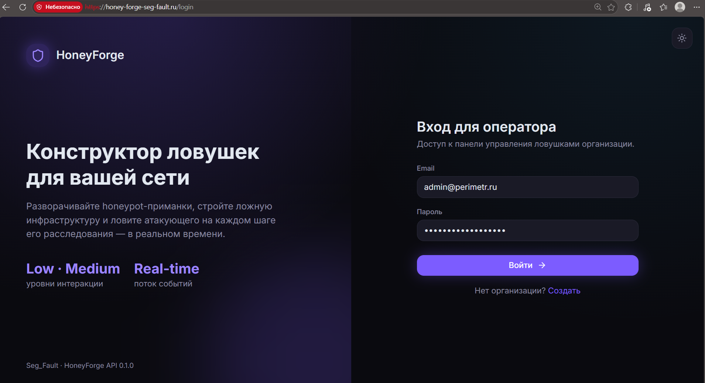
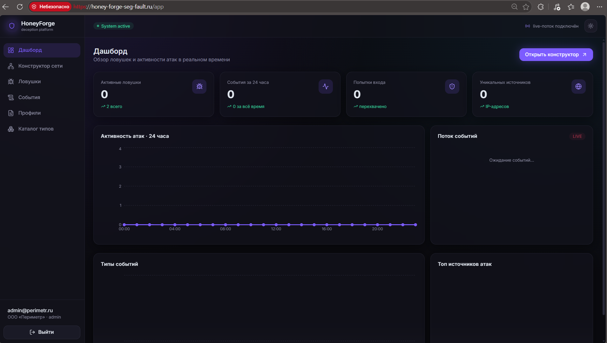
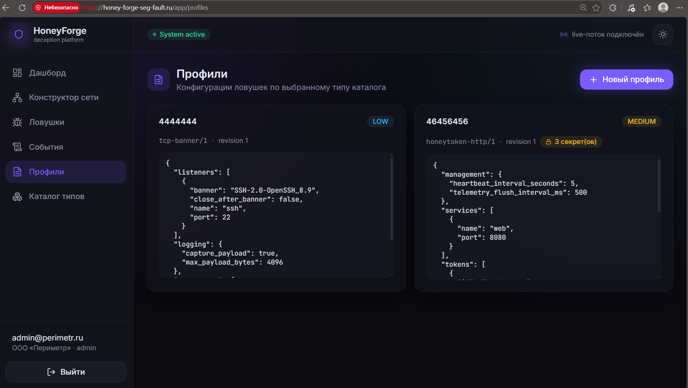
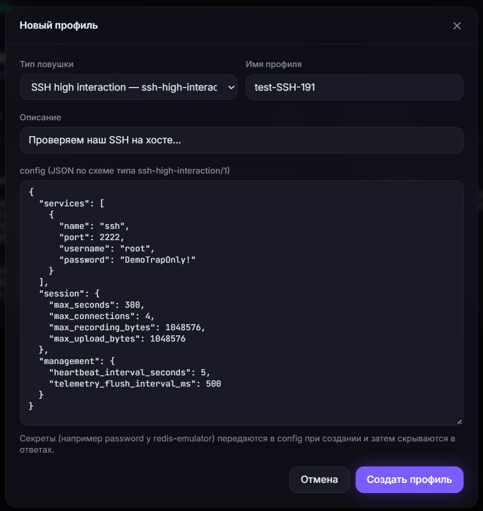
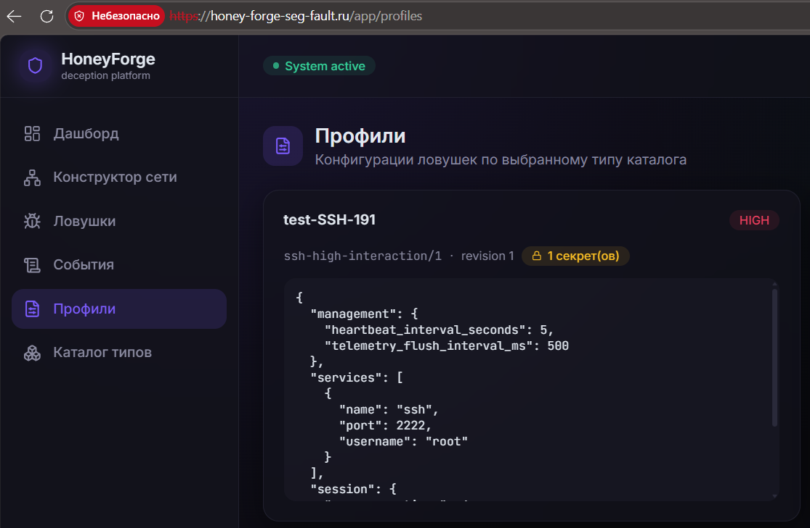
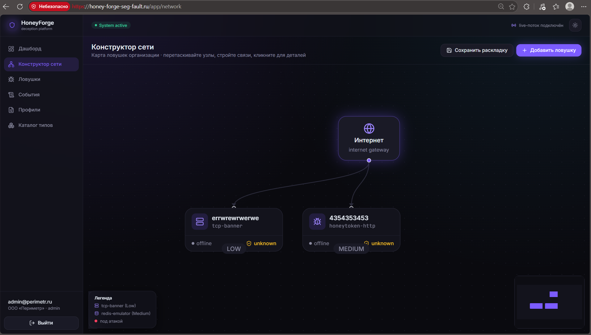
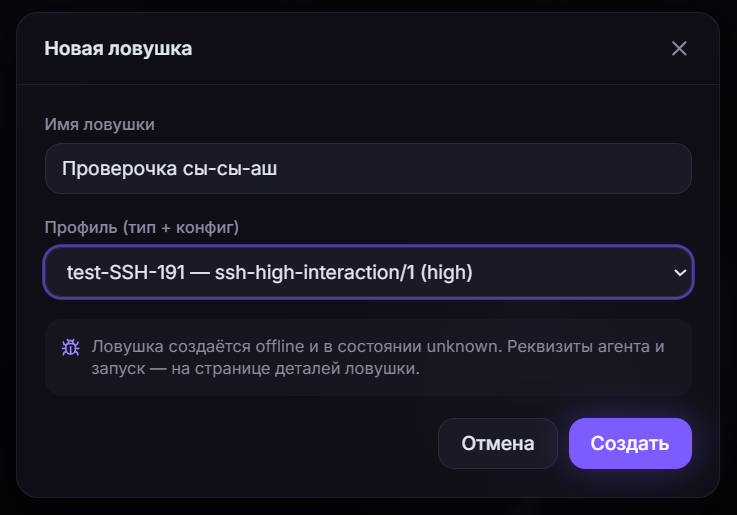
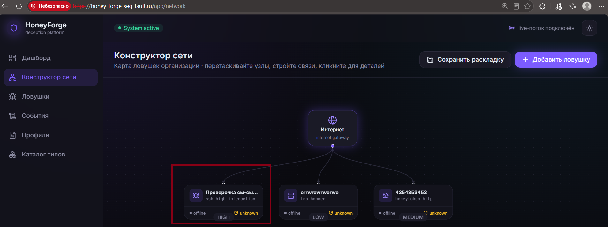
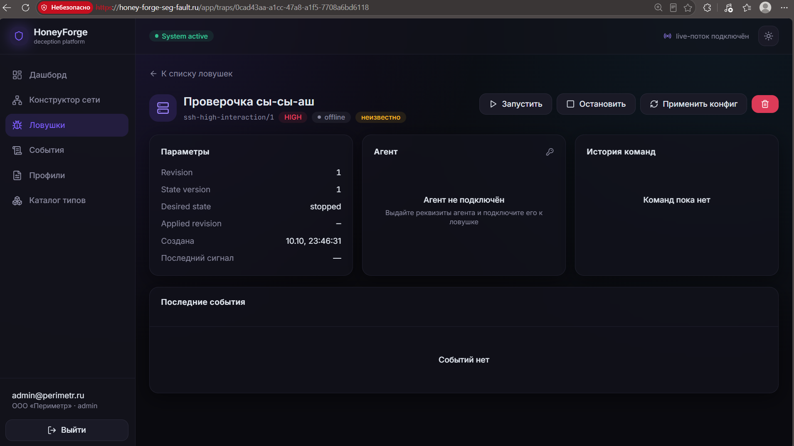

# HoneyForge

Документ описывает фактически работающую демо-платформу по адресу:
```
https://honey-forge-seg-fault.ru
```
##### *по состоянию на 10 октября 2026.

Без предположений — только то, что подтверждено скриншотами, логами и проверками.


## 1. Что такое HoneyForge (в одном абзаце)
HoneyForge — веб-платформа для развёртывания и управления сетью honeypot-ловушек («декой»). Оператор через веб-интерфейс создаёт профили конфигурации, разворачивает ловушки разных типов (`tcp-banner`, `redis-emulator`), наблюдает за атаками в реальном времени, ставит команды (`start/stop/apply_config`), читает журнал событий с пойманными кредами и payload'ами. Backend — `Go + PostgreSQL + Kafka`, frontend — `React SPA`, всё за `nginx` с `TLS`. Есть отдельный `TCP-runtime` агента (`cmd/agent`), который запускается на хосте с ловушкой и подключается к `API` по `WSS`.

## 2. Скриншот «как есть» — что видит пользователь
URL: `https://honey-forge-seg-fault.ru/login`


→ после логина попадаем на главную страницу → `/app`


→ переходим во вкладку "профиль" → `/app/profiles`


→ создаём "карточку" профиля → `/app/profiles`


→ проверяем наличие "карточки" профиля → `/app/profiles`


→ переходим в раздел "сеть" → `/app/network`


→ переходим в раздел "добавить ловушку" и добавляем нашу ловушку → `/app/network`


→ проверяем раздел "сеть" ещё раз → `/app/network`


→ кликаем по ловушке и смотрим информацию → `/app/traps/<uuid>`


../