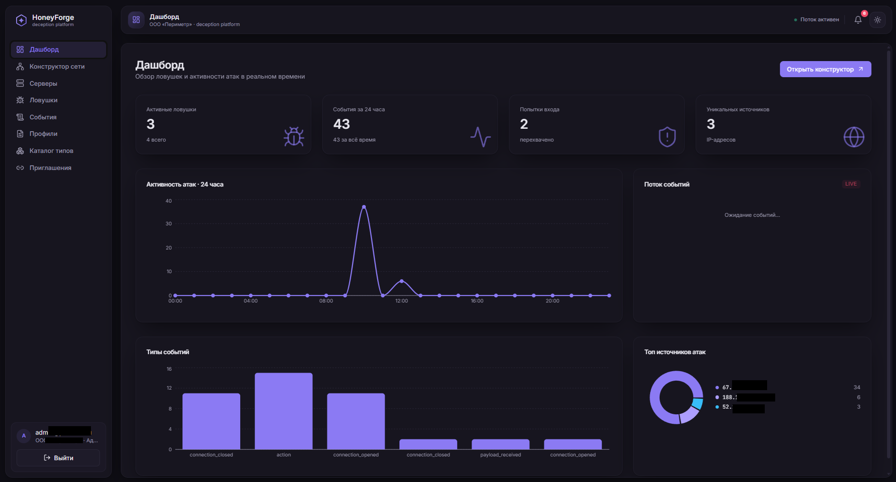
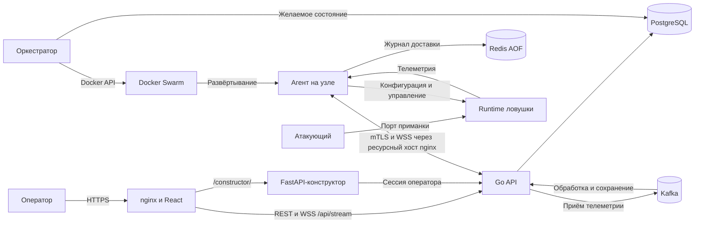
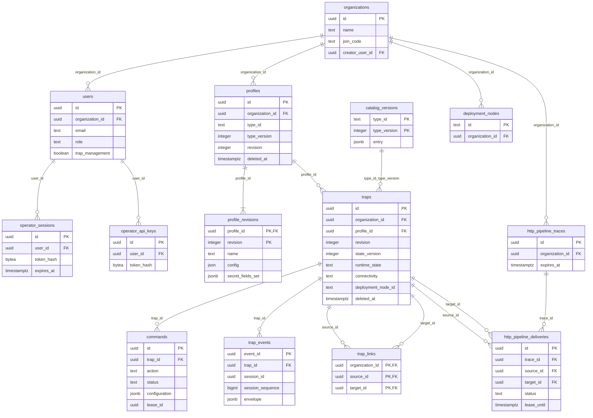

# HoneyForge

HoneyForge — платформа для создания и развёртывания honeypot-ловушек. Оператор задаёт поведение сервиса, запускает ловушку на выбранном сервере и наблюдает за подключениями, командами и действиями атакующего в общей панели.



- [Запуск](#запуск)
- [Первый сценарий](#первый-сценарий)
- [Архитектура](#архитектура)
- [Профили и типы ловушек](#профили-и-типы-ловушек)
- [API](#api)
- [База данных](#база-данных)
- [Разработка и проверки](#разработка-и-проверки)

## Запуск

Нужны Git, Docker Engine и Docker Compose с поддержкой `include`. На Windows используйте Docker Desktop в режиме Linux-контейнеров. Оркестратор использует Docker Swarm; при первом запуске он сам создаёт локальный Swarm и сети ловушек.

Из корня репозитория:

```sh
docker compose up --build -d
docker compose ps -a
```

Панель: **https://localhost:8443**. Конструктор: **https://localhost:8443/app/constructor**. На Windows эту же сборку запускает `./start.ps1`.

Для стандартного локального запуска не нужны `.env`, установленные на хосте Go/Python или ручная генерация сертификатов. Сервис `tls-init` создаёт секреты и сертификаты в Docker-томах и обновляет сертификаты. Локальный HTTPS использует собственный CA: браузер попросит подтвердить доверие к сертификату.

`compose.yaml` подключает `docker-compose.real.yml`, поэтому явный эквивалент команды запуска:

```sh
docker compose -f docker-compose.real.yml up --build -d
```

Вместе запускаются панель nginx/React, Go API, Python-конструктор, PostgreSQL, Kafka, Redis и оркестратор. Сервисы `decoy-*-image` и `ssh-sandbox-image` подготавливают образы и завершаются: состояние `Exited (0)` для них ожидаемо.

Панель по умолчанию доступна только на `127.0.0.1:8443`. Порты ловушек публикуются отдельно согласно профилям. Для панели и агентского канала используются разные имена: `localhost` и `resources.localhost`.

### Логи и остановка

```sh
docker compose logs --tail=100 api orchestrator constructor web
docker compose stop
docker compose start
```

`stop` сохраняет контейнеры и тома. Управляемые ловушки работают как отдельные Swarm-сервисы: останавливайте их кнопкой «Остановить» в панели до остановки управляющего стека. Остановка Compose сама по себе не удаляет Swarm-ловушки.

### Если запуск не завершился

| Симптом | Что проверить |
|---|---|
| Панель не открывается | Состояние `web` и `api`, свободен ли порт 8443, логи `tls-init`. |
| API не запускается | Готовность PostgreSQL/Kafka и логи `api`; миграции выполняются при старте. |
| Ловушка создана, но не работает | Логи оркестратора, `docker service ls`, состояние агента и историю команд в панели. |
| Ошибка запуска listener | Не занят ли порт другой программой или ловушкой на выбранном узле. |
| Агент offline | Доступность `resources.localhost` из управляющей сети, доверие к CA и Redis. Для другого сервера нужны доступные ему адреса установки. |

### Развёртывание на сервере

Полный стек рассчитан на Linux-хост с Docker. Для внешнего доступа настройте DNS, действующие сертификаты и раздельные имена панели и агентского ресурса. В конфигурации согласуйте `API_PUBLIC_ORIGIN`, `BROWSER_ORIGINS`, `AGENT_WS_URL`, адрес публикации панели и frontend API URL. Пример nginx: [deploy/nginx/honey-forge.conf](deploy/nginx/honey-forge.conf).

`MGMT_BIND_IP` задаёт интерфейс панели, `DECOY_BIND_IP` — интерфейс приманок. Сети управления и приманок разделены. Дополнительные Linux-серверы присоединяются к Swarm как workers и назначаются организации; список доступных узлов виден в разделе «Серверы». Образы ловушек должны присутствовать на выбранном узле.

## Первый сценарий

1. Откройте панель и зарегистрируйте организацию: первый пользователь получает права администратора.
2. В разделе профилей выберите тип ловушки, задайте имя, свободный порт и конфигурацию.
3. Создайте ловушку по профилю. При необходимости выберите сервер размещения; без выбора используется узел платформы.
4. Дождитесь `online` у агента и `running` у runtime. Создание ресурса в API ещё не означает готовность listener.
5. Подключитесь к адресу сервера на порту ловушки. Для TCP-banner можно использовать `nc SERVER_IP PORT`.
6. Проверьте раздел «События» и карточку ловушки. Команды остановки и запуска доступны там же.

Для собственного сценария откройте конструктор, добавьте TCP- или HTTP-вход, соедините блоки поведения и нажмите «Развернуть». Доска и работающая ловушка — разные объекты: удаление доски не удаляет созданную ловушку. Подробнее: [README конструктора](constructor/README.md).

## Архитектура

Управляющий backend — модульный монолит на Go: HTTP и WSS, авторизация, каталог, профили, ловушки, команды и события находятся в одном Go-модуле. Отдельные процессы выполняют развёртывание контейнеров и работу агентов. Конструктор на FastAPI использует текущую сессию панели и обращается к тому же API.



У обычных TCP/Redis/HTTP-ловушек агент и runtime работают в отдельных контейнерах. Доверенный агент имеет доступ к управлению, а контейнер приманки не получает Docker socket или управляющие секреты; обмен идёт через TLS поверх stdin/stdout. Для SSH шлюз создаёт отдельный Linux-контейнер на соединение и записывает терминал и SFTP снаружи этой среды.

### Основные потоки

**Создание:** панель → профиль → `POST /api/traps` → оркестратор → Swarm-сервис → подключение агента → `apply_config` → `start` → listener. Развёртывание асинхронное; состояние и ошибки возвращаются через карточку ловушки и историю команд.

**Телеметрия:** runtime → журнал агента в Redis → WSS → Kafka → PostgreSQL → уведомление панели. Агент получает подтверждение пакета после записи в PostgreSQL. Redis сохраняет неподтверждённые данные для повторной доставки; backend проверяет дубликаты событий и пакетов.

**Изменения панели:** бизнес-изменение, аудит и запись журнала фиксируются в одной транзакции PostgreSQL. `/api/stream` передаёт изменения текущей организации и поддерживает восстановление по курсору. REST остаётся источником подробных данных.

### Компоненты и код

| Компонент | Ответственность | Расположение |
|---|---|---|
| Панель | Ловушки, события, профили, организация | `frontend/src` |
| API | REST/WSS и сборка модулей | `src/backend/cmd/api`, `internal/app` |
| auth | Пользователи, сессии, API-ключи, права | `src/backend/modules/auth` |
| catalog / profiles | Версии типов, JSON Schema, конфигурации | `src/backend/modules/catalog`, `modules/profiles` |
| traps / commands | Состояние ловушки, реквизиты и выполнение команд | `src/backend/modules/traps`, `modules/commands` |
| events / audit | Телеметрия и история действий операторов | `src/backend/modules/events`, `modules/audit` |
| agentws / frontendws | Потоки агента и панели | `src/backend/modules/agentws`, `modules/frontendws` |
| Агент и runtime | Исполнение профиля, буферизация, протокол приманки | `src/backend/cmd/agent`, `internal/agent`, `internal/decoys` |
| Оркестратор | Согласование состояния API и Docker | `src/backend/cmd/orchestrator`, `internal/orchestrator` |
| Конструктор | Доски, блоки поведения, компиляция и развёртывание | `constructor/backend`, `constructor/static` |

HTTP-обработчик связывает JSON и вызывает сервис; сервис проверяет бизнес-правила и права; репозиторий выполняет параметризованный SQL через pgx. Общие транспортные правила находятся в `internal/contract`, транзакционные изменения — в `internal/mutation`.

## Профили и типы ловушек

**Тип** задаёт протокол, схему конфигурации, события и допустимые действия. **Профиль** хранит конфигурацию конкретной версии типа. **Ловушка** связывает профиль с развёрнутым экземпляром и его состоянием.

| Тип и версия | Назначение |
|---|---|
| `tcp-banner/1` | Один или несколько TCP-listener: приветствие, захват входящих данных, закрытие после баннера. |
| `redis-emulator/1` | Redis-приманка с настоящим redis-server, наблюдением за входом и командами. |
| `honeytoken-http/1` | HTTP-раздача файлов, ключей и URL-приманок; события использования honeytoken. |
| `ssh-high-interaction/1` | SSH-сессия в отдельном Linux-контейнере, запись терминала и SFTP. |
| `ssh-high-interaction/2` | SSH с дополнительными событиями `process.exec` от Tetragon. Сенсор устанавливается оператором отдельно на Linux-узле. |
| `custom-tcp/1` | Текстовые ответы и правила, собранные в конструкторе. |
| `custom-http/1` | HTTP-граф: входы, разбор данных, условия, преобразования и ответы. |
| `custom-http/2` | HTTP-граф с передачей JSON между отдельно развёрнутыми ловушками. |

Актуальные дескрипторы доступны через `/api/trap-types`; версии неизменяемы. Клиент должен брать `config_schema`, `event_schemas` и `actions` из каталога выбранной версии.

### Конфигурация профиля

У профиля есть `id`, `name`, `description`, `type_id`, `type_version`, `config`, `revision`, `created_at`, `updated_at` и `secret_fields_set`. Версия типа задаёт формат, а `revision` меняется при изменении самого профиля.

Пример тела `POST /api/profiles`:

```json
{
  "request_id": "fa0cf214-c459-4248-8f98-fd9ee92739a9",
  "name": "SSH banner",
  "description": "TCP-приманка на порту 2222",
  "type_id": "tcp-banner",
  "type_version": 1,
  "config": {
    "listeners": [
      {
        "name": "ssh",
        "port": 2222,
        "banner": "SSH-2.0-OpenSSH_9.2p1\r\n",
        "close_after_banner": false
      }
    ],
    "logging": { "capture_payload": true, "max_payload_bytes": 4096 },
    "management": { "heartbeat_interval_seconds": 5, "telemetry_flush_interval_ms": 500 }
  }
}
```

Этот профиль отправляет TCP-баннер; для интерактивной SSH-сессии выберите `ssh-high-interaction`.

### Изменение, применение и секреты

- `PATCH` и `DELETE /api/profiles/{id}` требуют точный `If-Match` из последнего ответа, например `"profile:PROFILE_ID:1"`. Изменение устаревшей ревизии отклоняется.
- Изменение профиля не меняет работающий runtime автоматически. Команда `apply_config` закрепляет снимок указанной ревизии; последующее редактирование профиля не меняет уже поставленную команду.
- `PATCH config` заменяет несекретную конфигурацию. Пропущенные поля с `writeOnly` сохраняются; для удаления секрета используется `clear_secret_fields` с JSON Pointer. Одновременные назначение и очистка одного секрета запрещены.
- Секретные значения отсутствуют в публичном `config`; `secret_fields_set` показывает пути установленных секретов. Полный снимок доступен доверенному агенту и внутренней обработке команды.
- Используемый живой ловушкой профиль удалить нельзя. После удаления последней связанной ловушки профиль автоматически удаляется из активного списка; ревизии и история сохраняются.

Профили читает участник организации; создаёт и меняет администратор. Делегированное право управления ловушками не даёт права редактировать профили.

## API

Локальный адрес: `https://localhost:8443`. Полный HTTP-контракт со схемами, параметрами и ответами: [api/openapi.yaml](api/openapi.yaml). Ниже — основные группы маршрутов.

| Методы и путь | Назначение |
|---|---|
| `POST /api/registrations` | Создать организацию с администратором либо присоединиться по коду. |
| `POST /api/sessions` | Войти и получить cookie-сессию. |
| `GET`, `DELETE /api/session` | Текущая сессия / выход. |
| `GET /api/organization` | Организация текущего пользователя. |
| `GET /api/organization/join-code`, `POST /api/organization/join-code/rotations` | Получить / перевыпустить код приглашения. |
| `GET /api/organization/members` | Участники организации. |
| `PATCH /api/organization/members/{id}/trap-permission` | Делегировать управление ловушками. |
| `GET`, `POST`, `DELETE /api/admin-session` | Проверить, подтвердить паролем или закрыть административный доступ. |
| `GET`, `POST /api/api-keys`, `DELETE /api/api-keys/{id}` | Список, выпуск и отзыв ключей автоматизации. |
| `GET /api/trap-types` | Каталог типов. |
| `GET /api/trap-types/{type_id}/versions/{type_version}` | Дескриптор точной версии. |
| `GET`, `POST /api/profiles` | Список и создание профилей. |
| `GET`, `PATCH`, `DELETE /api/profiles/{id}` | Чтение, изменение и удаление профиля. |
| `GET /api/traps/deployment-nodes` | Узлы, назначенные организации. |
| `GET`, `POST /api/traps` | Список и создание ловушек. |
| `GET`, `PATCH`, `DELETE /api/traps/{id}` | Состояние, изменение и удаление ловушки. |
| `GET`, `POST`, `DELETE /api/traps/{id}/agent-credentials` | Статус, выдача и отзыв реквизитов агента. |
| `GET`, `POST /api/traps/{id}/commands` | История и постановка команд. |
| `GET /api/traps/{id}/commands/{command_id}` | Результат конкретной команды. |
| `GET /api/events`, `GET /api/events/{event_id}` | Список событий и подробные данные. |
| `GET /api/events/export`, `GET /api/events/recordings/{session_id}` | Экспорт событий и записи SSH-сессий. |
| `GET /api/audit-entries`, `GET /api/audit-entries/{audit_id}` | История действий операторов. |
| `GET`, `POST /api/trap-links`, `DELETE /api/trap-links/{source}/{target}` | Направленные связи между ловушками. |
| `WSS /api/stream` | Изменения для панели; подпротокол `dashboard-stream.v1`. |
| `WSS /assets/stream` на ресурсном хосте | Команды, heartbeat и телеметрия агента. |

Доски конструктора доступны через `/constructor/api/chains`, типы блоков — через `/constructor/api/registry`; запуск доски — `POST /constructor/api/chains/{chain_id}/deploy`. Эти запросы проходят через nginx в FastAPI и используют сессию панели.

### Доступ и формат запросов

Браузер использует защищённую cookie-сессию. Изменяющие запросы передают разрешённый `Origin` и `X-CSRF-Token`, полученный из сессии. Для автоматизации используется `Authorization: Bearer API_KEY`; ключ действует в рамках организации и прав его владельца. Управление ключами, сессией и административным доступом требует браузерной сессии.

Создающие операции с `request_id` используют UUID для защиты от повторного выполнения. При повторе отправляйте тот же идентификатор и те же данные. У списков с пагинацией используйте `limit` и возвращённый `next_cursor`; доступные фильтры указаны в OpenAPI. Время передаётся в RFC 3339.

API отвергает неизвестные JSON-поля и ограничивает тело запроса 256 KiB. Конфигурация профиля ограничена 128 KiB и проверяется по JSON Schema типа.

Пример ошибки:

```json
{
  "error": {
    "code": "validation_failed",
    "message": "Request validation failed"
  },
  "request_id": "df7770b9-6ce2-40e1-9fd8-16892b16285d"
}
```

| Код HTTP | Значение |
|---|---|
| `200`, `201`, `204` | Чтение/повтор создания, создание с `Location`, успешное действие без тела. |
| `400`, `413`, `415`, `422` | Некорректный JSON, превышение размера, неподдерживаемый media type, нарушение правил валидации. |
| `401`, `403`, `404` | Нет аутентификации, нет разрешения, ресурс отсутствует или не виден текущей организации. |
| `409`, `412`, `428` | Конфликт состояния, устаревшее предусловие, отсутствующее обязательное предусловие. |
| `429`, `503` | Лимит запросов, временная недоступность зависимости. |

### Создание ловушки и команды

После создания профиля передайте его `id` в `POST /api/traps`:

```json
{
  "request_id": "67980dba-8b30-4607-aad1-938ad9184878",
  "name": "DMZ SSH banner",
  "profile_id": "7a4fc2b1-dd15-4051-86d6-6fd71a143091"
}
```

Замените `profile_id` на полученный идентификатор. Для выбранного worker добавьте `deployment_node_id` из `/api/traps/deployment-nodes`. В стандартном Compose оркестратор сам выдаёт реквизиты и ставит первоначальные `apply_config` и `start`.

Для ручного применения новой ревизии — `POST /api/traps/{id}/commands`:

```json
{
  "request_id": "12f58682-9bb5-4257-b215-f453f570bdb0",
  "action": "apply_config",
  "params": { "profile_revision": 2 }
}
```

Для `start` и `stop` передайте `params: {}`. У одной ловушки одновременно допускается одна активная команда. Итог смотрите по `status`: `queued`, `running`, `succeeded`, `failed`, `expired`. Состояние связи агента (`online`/`offline`) и состояние runtime (`unknown`/`running`/`stopped`/`error`) различаются.

Изменение и удаление ловушки используют `X-Expected-Revision`. `revision` защищает редактируемые поля, а `state_version` отражает обновления рабочего состояния и не подменяет эту проверку.

## База данных

PostgreSQL хранит пользователей, конфигурации, состояние ловушек, команды, события и аудит. Goose применяет timestamp-миграции из [migrations](migrations) при запуске API.

Ниже — основные таблицы и внешние ключи. Служебные таблицы повторов, аудита и курсоров описаны после схемы. Составные связи по организации сокращены до одной линии; полный DDL находится в миграциях.



### Хранение и ограничения

| Таблицы / хранилище | Что хранится |
|---|---|
| `profiles`, `profile_revisions` | Идентичность профиля и неизменяемые снимки ревизий с конфигурацией. Текущая ревизия профиля ссылается на снимок. |
| `catalog_versions`, `schema_versions` | Версии дескрипторов и схем. Обновление и удаление установленных версий запрещают триггеры. |
| `commands` | Действие, закреплённый снимок конфигурации, lease и результат. Уникальный частичный индекс запрещает две активные команды одной ловушки. |
| `trap_ingestions`, `trap_event_batches` | Резервации и подтверждения пакетов телеметрии; `trap_events` дополнительно защищён уникальностью последовательности внутри сессии ловушки. |
| `profile_requests`, `mutation_requests` | Идентификаторы и отпечатки запросов для идемпотентности. |
| `auth_audit`, `profile_audit`, `mutation_audit` | Аудит; представление `audit_entries` объединяет записи для чтения. |
| `auth_changes`, `profile_changes`, `mutation_changes`, `organization_changes`, `frontend_catalog_state` | Журнал изменений и границы восстановления потока панели. |
| `deployment_nodes` | Наблюдаемое состояние назначенных организации Swarm-узлов. Поле `traps.deployment_node_id` хранит выбор узла без FK к этой таблице. |
| `http_pipeline_traces`, `http_pipeline_deliveries` | Контекст и долговечная очередь доставки между HTTP-ловушками. |
| Kafka | Журнал входящей телеметрии перед обработкой. |
| Redis | Журнал агента с AOF и `appendfsync always`, без вытеснения записей. |
| Том `constructor_data` | JSON-доски конструктора, разделённые по организациям; они хранятся отдельно от PostgreSQL. |

Внешние ключи ловушек, команд и событий учитывают организацию. Удаление ловушки оставляет tombstone для истории и отзывает её реквизиты. Секреты сессий и API-ключей хранятся как хеши; полные конфигурации профилей содержат установленные секреты и не выдаются в публичных ответах.

Данные PostgreSQL, Kafka, Redis и конструктора сохраняются в именованных Docker-томах. В локальном Compose `HISTORY_RETENTION` по умолчанию равен `24h`; фоновая очистка удаляет старую историю, сохраняя действующие настройки, активные команды и незавершённую доставку.

## Разработка и проверки

Go-модуль: `src/backend` (точные версии Go и зависимостей — в [go.mod](src/backend/go.mod)). Основные библиотеки: Gin, pgx/v5, Goose, validator/v10, gorilla/websocket и franz-go. Панель — React/TypeScript/Vite; конструктор — Python/FastAPI. PostgreSQL 17, Kafka и Redis задаются в Compose.

Проверки backend из `src/backend`:

```sh
go fmt ./...
go vet ./...
go test ./...
go build ./...
```

Тесты HTTP-runtime требуют Python 3; при нестандартном расположении задайте `HF_PYTHON` путём к интерпретатору. Для проверки гонок — `go test -race ./...`; на Windows нужны C-компилятор и `CGO_ENABLED=1`.

Проверки frontend из `frontend`:

```sh
npm ci
npm test
npm run build
```

Проверки конструктора из корня:

```sh
python -m pip install -r constructor/requirements.txt -r constructor/requirements-test.txt
python -m unittest discover -s constructor/backend -t . -p 'test*.py'
```

Интеграционные тесты Go запускаются через `go test -tags=integration ./...`. Используйте отдельную тестовую PostgreSQL-базу с правом создавать схемы: `TEST_DATABASE_URL` требует TLS и доверенный CA. Проверки Kafka/Redis используют `TEST_KAFKA_BROKERS`, `TEST_KAFKA_CA_FILE`, `TEST_REDIS_URL` и `TEST_REDIS_CA_FILE`; без нужных зависимостей часть тестов пропускается.

Для запуска API вне Docker нужны PostgreSQL, Kafka и TLS. Задайте `DATABASE_URL`, постоянный `CURSOR_KEY` (32 байта в Base64), `BROWSER_ORIGINS`, `API_PUBLIC_ORIGIN`, `AGENT_WS_URL`, `KAFKA_BROKERS`, `TLS_CERT_FILE`, `TLS_KEY_FILE` и CA соответствующих сервисов. Из `src/backend` выполните `go run ./cmd/api`; рабочая директория нужна для пути `../../migrations`. Агентский хост должен отличаться от операторского. Секреты храните вне Git.

Подробности: [бэкенд](src/backend/README.md), [frontend](frontend/README.md), [конструктор](constructor/README.md), [развёртывание ловушек](deploy/decoys/README.md), [агент](src/backend/internal/agent/README.md).
