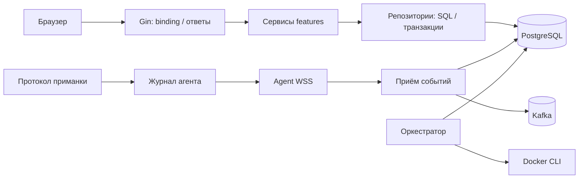

# Архитектурный рефакторинг — 12 октября 2026

## Результат и границы

Выполнен аудит backend, frontend, API-контрактов, миграций, сценариев запуска
и CI. Сохранён модульный монолит: API, агент, приманки и оркестратор остаются
в существующем Go-модуле. Новых зависимостей и инфраструктуры нет.
HTTP/WSS-маршруты, JSON, статусы, конфигурация развёртывания и SQL-миграции
не изменены. Внутренний интерфейс удаления профилей изменён вместе со всеми
его потребителями; сервис больше не получает транзакцию драйвера.

Главные инварианты: авторизация до побочных эффектов, изоляция организаций,
сохранение CSRF/TLS, точные ревизии и idempotency fingerprints, атомарные
удаление/аудит/уведомление, невозможность удаления используемого профиля,
ограничение TCP-сессий и корректная остановка, неизменность записанной телеметрии.

## Обнаруженные проблемы и изменения

| Проблема | Выполненное изменение |
|---|---|
| Два алгоритма точной канонизации JSON; SQL-код использовал пакет HTTP | Общие `platform/jsonvalue.Canonical` и `DecodeObject`; mutation, profiles и repository используют их. Старые функции httpx сохранены как совместимые делегаты. |
| Ошибки полей профиля были типами транспортного пакета | `platform/validation` владеет `FieldError`, путями и описанием ошибок validator. contract/httpx сохраняют прежние имена через aliases/delegates. |
| Классификация сбоев БД повторялась в трёх местах | Profiles использует `postgres.IsUnavailable`; auth использует общую проверку соединения и сохраняет собственную точную политику SQLSTATE. |
| Service/types профиля получали `pgx.Tx` | Репозиторий передаёт `BindingCheck`, замкнутый на ту же транзакцию. Сервис проверяет If-Match и привязки; SQL и блокировки остаются у репозитория. |
| TCP и Redis повторяли accept loop, лимит, failure и shutdown | Общий закрытый для остальных модулей `decoys/internal/tcpserver`; протоколы и телеметрия остаются в приманках. Сохранён общий лимит 64 сессий. |
| Типы приманок повторялись в Select, Ports и SupportedTypes | Одна таблица встроенных определений; порядок TCP/Redis/HTTP/SSH, версии, действия и сообщения ошибок сохранены. Возвращаемые capabilities независимы. |
| Чтение Journal отдаёт внутренние Events/Data | Pending и повторный Enqueue возвращают глубокие копии. Тест сначала воспроизвёл дефект, затем проверил неизменность, reopen и исходный Ack. |
| DockerCLI смешивал запуск CLI, сети, состояние и секреты | Разделён на docker.go, docker_network.go, docker_state.go и docker_secrets.go в том же пакете, без изменения команд. |
| Закрытие pool повторялось в каждой ошибке app.Open | Один deferred cleanup до передачи владения полностью собранному Runtime. |
| История событий зависела от конкретного Repository | Малый потребляемый интерфейс Read/List; unit-тесты проверяют admin/viewer, ошибки, отмену, отказ до обращения к хранилищу и передачу контекста. |
| Auth/profiles имели буквальные копии больших тестовых хранилищ | По одному feature-local `internal/teststore`; каждый тест создаёт собственный store. Небольшие JSON-помощники остаются локальными. |
| Commands create/replay/read/list subtests зависели от порядка | Каждый случай получает отдельный fixture и явно создаёт исходную команду. Успех и заголовки replay проверяются как раньше. |
| Четыре версии PostgreSQL fixtures и ручной запуск всех миграций | `internal/testpostgres` создаёт изолированную схему, регистрирует cleanup сразу и запускает production Goose. Поддержка URL и keyword DSN закреплена тестом. Намеренные legacy Up/Down проверки auth сохранены. |
| Frontend client смешивал транспорт, endpoints и session state | HTTP/ApiError вынесены в api/http.ts с прежним экспортом ApiError через client.ts; CSRF остаётся у сессии. |
| Cache и hooks дублировали query keys; форма смешивалась с графом | api/query-keys.ts — один источник ключей; форма вынесена в pages/network/AddTrapModal.tsx. Значения конфигурации и поведение формы сохранены. |
| Неиспользуемая зависимость и невоспроизводимая установка | Удалён неиспользуемый date-fns из manifest/lockfile; frontend Docker build использует npm ci. Удалён неиспользуемый приватный auth/http.readBody. |

## Структура и зависимости

```text
src/backend/
  internal/
    app/                         композиция приложения
    agent/                       runtime и durable journal
    decoys/
      internal/tcpserver/        общий lifecycle TCP/Redis
      tcptrap/, redistrap/, ...  самостоятельные протоколы
    orchestrator/
      docker.go                  вызовы CLI и конфигурация
      docker_network.go          Swarm и подключение сетей
      docker_state.go            чтение состояния/labels
      docker_secrets.go          trust и удаление ресурсов/секретов
    platform/
      jsonvalue/                 точные JSON-операции
      validation/                транспортно-независимые field errors
      httpx/                     HTTP binding и ответы
    testpostgres/                изолированные тестовые схемы
  modules/
    auth/internal/teststore/     общий fixture auth
    profiles/internal/teststore/ общий fixture profiles
    profiles/service/delete.go  правило удаления без драйвера БД
    events/history.go            use case и потребляемый store
frontend/src/
  api/http.ts                    HTTP-транспорт
  api/client.ts                  операции API и состояние сессии
  api/query-keys.ts               ключи cache/hooks
  pages/network/AddTrapModal.tsx форма создания
```



## Архитектурные решения

**ADR-1 — переносить общие механизмы при наличии действующих потребителей.**
JSON используют mutation/profiles, field errors — contract/httpx/profiles,
TCP lifecycle — TCP/Redis. Эти компоненты получили конкретные обязанности.
Цена решения — несколько небольших пакетов и совместимых делегатов в httpx.
Не объединены два HTTP binder: у них различаются null/presence и другие
опубликованные правила. Общего универсального framework нет.

**ADR-2 — транзакционную проверку привязок предоставляет репозиторий.**
BindingCheck действует только внутри callback удаления под FOR UPDATE.
ReadProfileForBinding сохраняет FOR SHARE до commit создаваемой привязки.
Проверка отдельным запросом до транзакции отвергнута: она допускает гонку.
Цена решения — миграция внутреннего store callback и тестовых fixtures.

**ADR-3 — общий TCP lifecycle, отдельные протоколы.**
Приманка сначала связывает все listeners и только затем передаёт владение
tcpserver. Сервер ограничивает сессии, запоминает первую ошибку и ожидает
закрытие handlers. SSH не подключён к этому механизму: политика перегрузки
у него отличается. Таблица типов объединяет только существующую регистрацию.

**ADR-4 — сохранить feature boundaries и технологический стек.**
Добавление приманки требует одной записи регистрации; история событий
тестируется через небольшой fake; изменение SQL-проверки профиля локально
репозиторию; ключи frontend cache редактируются в одном месте. Массовый перенос
modules, переписывание auth или замена Kafka/Redis отвергнуты: они имеют
действующих потребителей и не упрощают текущий пользовательский поток.

## Проверки

Проверки выполнялись на Windows, Go 1.27.2, из `src/backend`.

| Проверка | Результат |
|---|---|
| Исходный `go test ./...` | Успешно до рефакторинга. |
| Тест Journal перед исправлением | Обе ветки упали: reader изменял committed telemetry. После исправления проходят. |
| Целевые тесты изменённых модулей | Успешно, включая saturation/cancellation TCP, replay journal, delete bindings, точные JSON-числа и DSN. |
| Форматирование изменённых Go-файлов | goimports v0.51.0 и gofmt; файлы отформатированы. |
| `go fmt ./...` | Выполнен успешно. Позднее, по отдельному поручению исправить code style, весь backend отформатирован: развернуты функции/callbacks, разделены логические блоки и приведены к общему порядку импорты. |
| `go vet ./...` | Успешно. |
| `go test ./... -count=1` | Успешно, полный доступный набор. |
| `go build ./...` | Успешно. |
| `go test -tags=integration ./... -count=1 -json` | Exit 0: 1011 прошедших тестов/подтестов, 78 пропущенных; нет падений. |
| `go test -race ./...` | Недоступен: CGO выключен; повтор с CGO_ENABLED=1 подтвердил отсутствие gcc. |
| Реальные PostgreSQL/Kafka/Redis/Docker проверки | Не выполнены: отсутствуют TEST_DATABASE_URL, TEST_KAFKA_BROKERS, TEST_REDIS_URL и необходимая внешняя среда. Успешный запуск с тегом не считается приёмкой этих интеграций. |
| Frontend после рефакторинга | Проверки не запускались по указанию пользователя. Выполнен только аудит кода; исправлены замечания по импортам. |

После реализации повторно проверены ownership журнала, остановка goroutines,
границы сервисов, транзакционный callback, fixtures, wiring и совместимость
переноса frontend. Замечаний по бэкенду не осталось. В ходе финального чтения
исправлены импорты Server/Database и расширение импорта query-keys в cache.ts.

## Оставшиеся ограничения

- Race и реальная приёмка внешних сервисов требуют подготовленного окружения.
  SQL-миграции не менялись; выполнение их на новой БД здесь не подтверждено.
- Изменения frontend после рефакторинга не проверены исполнением по просьбе
  пользователя. Его исходный сбой Vite до этой просьбы был связан со старым
  локальным node_modules и исчез после установки версий из lockfile.
- Сохранены отдельные форматы mapping ошибок и JSON binding там, где их
  объединение изменило бы контракт. Сохранены существующие package paths и
  совместимые aliases; нет необходимости механически уплощать все модули.
- Интеграционные сценарии обеспечивают значительную часть SQL/HTTP coverage;
  без инфраструктуры это покрытие не подтверждено локально. Новые unit-тесты
  добавлены для затронутых правил, а не для искусственного процента покрытия.
