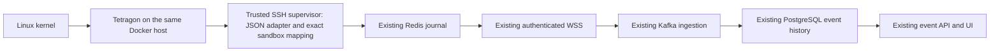

# Host telemetry: integration plan and operational status

## Repository reconnaissance (2026-10-13)

The supplied `HoneyForge_Stealth_Telemetry_Codex.md` is a proposed specification,
not evidence of working capabilities. The implementation is Go/Gin, React/Vite,
PostgreSQL/pgx/Goose, Kafka and Redis; it is not FastAPI.

| Existing component | Reuse / current limitation |
| --- | --- |
| `internal/orchestrator` | Swarm services, organization/node placement, generation, machine credentials |
| `internal/decoys/sshtrap` | SSH gateway outside one sandbox per connection; real shell and SFTP |
| `deploy/decoys/Dockerfile.sandbox` | Debian bookworm, UID 1000; not Ubuntu or container root |
| sandbox isolation | No network, read-only rootfs, bounded tmpfs/resources/PIDs, no-new-privileges, no Docker socket or management credentials |
| `internal/agent` | TLS pipe, bounded Redis journal, delivery retries/acks |
| `modules/agentws`, `modules/events` | Trap-scoped authenticated WSS, catalog validation, Kafka ingestion, PostgreSQL deduplication/history/retention |
| event API and frontend | Authorized history, details, filters, export and live notifications |
| catalog | Published versions immutable, including their event schemas |
| forwarding | TCP services and SSH gateway exist; arbitrary TCP/UDP forwarding was not found. SSH explicitly rejects port forwarding |
| host sensor | Neither Falco nor Tetragon exists in the baseline |

The development host is Windows. Docker CLI is absent. No Linux kernel, BTF,
eBPF, privileged sensor, real Docker event or PostgreSQL/Kafka E2E execution has
been verified here. These are operator acceptance requirements, not passing tests.

## Decision and invariants

Use Tetragon execution JSON for the first host-side source. Falco primarily
provides rule-driven alerts; it would need separate rules to reproduce a process
timeline. Do not add both. Do not change the existing sandbox OS, user or isolation.



The supervisor already owns Docker access. It consumes a local Docker exec pipe
from an operator-installed sensor; no new network endpoint or credentials enter
the sandbox. Mapping is established from the exact container created for a known
SSH session, using Docker inspect's full ID and StartedAt. Sensor labels, PID,
node name and payload trap IDs never grant authority. A truncated sensor Docker
ID may only resolve uniquely against active, fully inspected sandbox IDs; never
guess a match. Old/unmanaged/ambiguous events are discarded, with counters.

`trap_id` is the existing honeypot identity. Deployment is represented by the
existing positive generation, not a fabricated deployment UUID. Source IP/port
remain the gateway-observed peer of the associated SSH session, not a claimed
network observation by eBPF. Arguments are omitted by default, not parsed into
an invented argv array; Tetragon exposes a string. No environment or raw sensor
payload is retained. The existing session event budget and delivery failures
also apply to host events.

## Stages

1. Add immutable `ssh-high-interaction/2` with bounded `process.exec` data;
   preserve `/1` byte-for-byte. Test configuration, runtime capabilities and
   catalog rejection for malformed data. No SQL migration or dependency needed.
2. Add a versioned Tetragon JSON adapter and active sandbox mapping, with tests
   for two containers, ambiguous IDs, timestamps, missing fields, huge records,
   replay, secret omission and shutdown. Wire only `/2`; fail visibly if the
   explicitly required sensor is unavailable. `/1` keeps its current behavior.
3. Reuse storage/API/live history; test trap and organization authorization,
   snapshot validation, duplicate ingestion and frontend rendering. Document the
   additive contract in OpenAPI.
4. Supply opt-in configuration and Linux preflight/demo instructions. Run full
   local checks; operator must perform genuine kernel-to-UI acceptance. Privileged
   sensor installation is an operator action and is not performed by this change.

Network probes, arbitrary TCP/UDP forwarding, independent deployment telemetry,
file probes and durable replay of the sensor-to-supervisor stream remain later
stages. Existing journal durability begins after supervisor acceptance; it does
not prove lossless kernel capture. Supervisor restart closes SSH sessions and
creates new sandboxes, so mappings must not be recovered by guessing old sessions.

## Sources

- [Tetragon Docker installation](https://tetragon.io/docs/getting-started/install-docker/)
- [Execution JSON and Docker ID example](https://tetragon.io/docs/getting-started/execution/)
- [API field reference](https://tetragon.io/docs/reference/grpc-api/)

## Operator runbook (Linux only, not executed here)

Use a controlled Linux Docker node. The upstream quickstart was tested with
Ubuntu 22.04/22.10 and kernels 5.15/5.19; this is not an exhaustive compatibility
guarantee. Verify BTF, kernel lockdown/BPF permissions and the selected runtime
on the actual node. Windows and Docker Desktop are not validated targets.

Run the read-only checks on **every** node that can host an SSH trap:

```sh
sh deploy/telemetry/preflight.sh
```

Only the operator installs the privileged sensor. Review this explicit command
before executing it. It publishes no ports, uses no decoy network, and disables
raw JSON file export (which could otherwise retain host process arguments).
The v1.7.0 image is a compatibility target, not a claim that it was tested here.

```sh
docker run --detach --name tetragon --restart unless-stopped \
  --pid=host --cgroupns=host --privileged --network=none \
  --mount type=bind,source=/sys/kernel/btf/vmlinux,target=/var/lib/tetragon/btf,readonly \
  --log-driver local --log-opt max-size=10m --log-opt max-file=3 \
  quay.io/cilium/tetragon:v1.7.0 \
  --export-filename= --enable-process-environment-variables=false
```

Keep its gRPC server on the sensor container's own localhost. Do not attach the
sensor to the trap network or expose gRPC publicly. The current adapter checks
the exact pinned image reference and requires the standard `tetra` CLI plus
`sh`/`cat` in that image. A digest-only image reference or different version
requires an explicit adapter compatibility update, not disabling this check.

Set `TETRAGON_CONTAINER=tetragon` for the orchestrator (supported by
`docker-compose.real.yml`). The sensor must have the same name on each selected
Swarm node. Rebuild the API/orchestrator/SSH images and restart the control stack
using the project's established deployment procedure. The API installs the new
immutable catalog version at startup; there are no SQL migrations or new Go
dependencies in this change.

Create a **new** profile with `type_id=ssh-high-interaction`, `type_version=2`.
The service/session/management configuration is unchanged from version 1. Bind
a test trap and start it through the existing UI. Existing version 1 profiles
remain version 1; no automatic profile conversion is performed. Version 2
requires the sensor and reports runtime/deployment failure if unavailable.
Startup failure uses the existing `runtime_start_failed` status rather than
incorrectly claiming that the SSH port is occupied; details remain in logs.

The orchestrator supplies `NM_TETRAGON_CONTAINER`, `NM_INSTANCE_ID` and
`NM_DEPLOYMENT_GENERATION` to the trusted supervisor. Native SSH gateway children
receive only these nonsecret settings and the existing sandbox/Docker settings;
attacked sandboxes receive neither those settings nor machine credentials.
`host_id` is the Docker daemon's ID, read from the same endpoint used to create
and inspect the sandboxes, rather than an untrusted sensor node name.

### Automated laboratory checks

After separately installing the sensor and building the existing sandbox image:

```sh
cd src/backend
export TEST_TETRAGON_DOCKER=1
export NM_TETRAGON_CONTAINER=tetragon
export NM_SANDBOX_IMAGE=honeyforge/ssh-sandbox:local
go test -tags=integration ./internal/decoys/sshtrap -run TestTetragonDockerExecutions -v -count=1
```

That test creates two ordinary isolated SSH sandboxes and requires all three
real process executions in each corresponding session. It does not install a
sensor or contact third-party systems. With a dedicated PostgreSQL test database
configured according to the main README, run:

```sh
go test -tags=integration ./internal/app -run TestHostTelemetryPersistsAndRespectsOrganization -v -count=1
go test -tags=integration ./modules/catalog -run TestRepositoryInstall -v -count=1
go test -race ./...
```

The PostgreSQL test uses a synthetic normalized event and verifies actual
storage, event API filtering, deduplication and organization isolation. It is
separate from the real kernel-sensor test; neither alone proves the whole path.

### Manual kernel-to-UI acceptance

1. Start two version 2 traps on the controlled host; open an SSH session to each.
2. Run `/usr/bin/id`, `/usr/bin/uname -a`, `/usr/bin/ls /tmp`.
3. In Events or the trap history filter `process.exec`; open details and verify
   binary, PID/UID, full container ID, start time, generation and correct trap /
   SSH session. Compare the full ID with operator-side `docker inspect`.
4. Run `cd /tmp` in a shell and explain why a builtin need not generate an exec.
5. Verify `id -u` remains 1000, network remains `none`, no Docker socket or
   management secrets appear inside the sandbox, and no host privileges were added.
6. Stop the sensor. Version 2 must report a runtime failure rather than continue
   silently without host telemetry. Version 1 traps continue their existing flow.
7. Restart the sensor and restart the version 2 trap; new SSH sessions must have
   newly inspected mappings. Events for destroyed/unrelated containers must not
   be assigned to any active session. Check that stopping the gateway ends its
   `tetra getevents` subscription rather than accumulating readers in the sensor.
8. Temporarily interrupt the collector in the lab, inspect the existing bounded
   journal/retries and restore connectivity. Confirm replay produces one stored
   event. Overflow or failed durable acceptance stops the runtime; do not claim
   lossless capture before journal acceptance.

## Implementation and verification status

Implemented: version 2 catalog/runtime capability, bounded Tetragon parser,
trusted Docker inspection and session mapping, host exec delivery through the
existing journal/ingest/API, escaped process detail UI, OpenAPI, opt-in config,
operator preflight and both sensor/PostgreSQL integration tests.

The parser fixture is synthetic and follows the documented Tetragon JSON shape;
it is **not** a capture from this host. Real capture compatibility, Linux sandbox
execution, eBPF availability, kernel drop rate and latency remain unmeasured.

Before Docker inspection completes, startup execs can be discarded as
unattributed. Mapping removal before sandbox destruction also excludes teardown
execs. This first slice covers executions during an active, inspected SSH session.
Only execution events are subscribed; no file/network probes are implied. A
sensor EOF, malformed/oversized record or journal error fails version 2 visibly;
there is no automatic sensor reconnection or durable sensor-side replay. Accepted
and unattributed counters are logged when the reader stops. Sensor ring-buffer
loss has to be monitored separately with Tetragon metrics in a later stage.

Local checks: Go fmt/vet/test/build succeeded; frontend tests (75), TypeScript
and production build were executed. PostgreSQL integration tests were skipped
without `TEST_DATABASE_URL`; real sensor tests require `TEST_TETRAGON_DOCKER=1`
on Linux. Race testing was attempted both with the environment default and with
CGO enabled, and could not run because this Windows host has no GCC compiler.

Next stage: operator executes the real acceptance above and supplies the pinned
sensor's captured fixture; then implement measured sensor health/drop reporting,
reconnection/replay policy, and only subsequently network/file telemetry. No
claim of absolute invisibility, complete shell recording by execve or VM-level
isolation is made.
